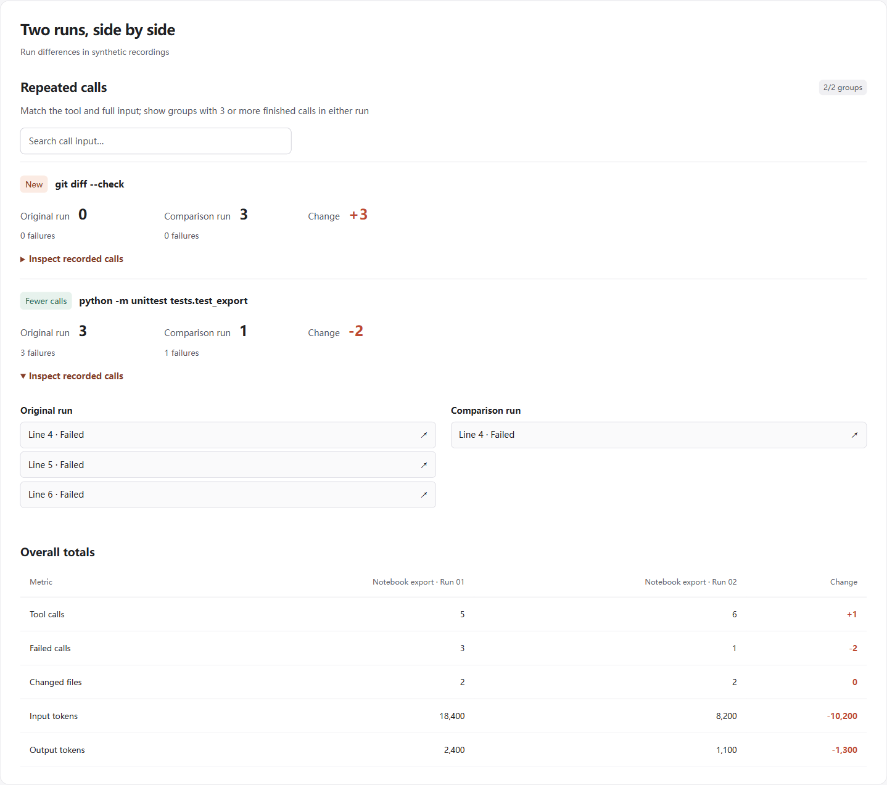

# Agent Rewind

### A replay button for your Codex sessions

[Open a recording →](https://chenpingan-dev.github.io/agent-rewind/) · [Install](#replay-a-session) · [English](README.md) / [简体中文](README.zh-CN.md)

[](https://github.com/chenpingan-dev/agent-rewind/actions/workflows/ci.yml) [](LICENSE)

Agent Rewind is an **offline Codex CLI log viewer and session replay tool for AI agent debugging**. Turn exported `codex exec --json` (JSONL) logs into a searchable HTML report, trace failed tool calls back to their input and output, and compare recorded token usage across two runs.

中文：本地 Codex 日志查看器与 AI 编码会话回放工具，用于排查失败调用、重复命令，并对比运行记录


- **Replay the steps** — move through a session with the playback controls or jump along the track
- **Debug tool calls** — open repeated commands, failed calls and large outputs at their recorded source
- **Compare two runs** — see changes in calls, failures and recorded token usage
- **Track repeated inputs** — see which call groups appeared, increased, decreased or disappeared, then open their source steps



In **Compare runs**, repeated inputs are grouped when either recording has at least three completed or failed calls. Each row shows both counts, failure counts and the change; expand **Inspect recorded calls** to jump to a source line in either run. Search covers the displayed title and input.

Matching uses the same tool identity and full recorded input before redaction or truncation, so similar-looking commands remain separate. It does not infer whether a repeat was necessary or a problem was fixed. Reports created before v0.1.2 still open; regenerate both runs with the current CLI to enable group comparison. The view shows the first 100 matching groups and up to 30 source links per run, while replay and JSON retain all records.

Reads exported Codex exec JSONL. Runs locally with Python's standard library. Reports open offline, with 中文 / English built in.

<a id="try-it-in-one-minute"></a>

## Replay a session

Python 3.11+; analysis uses only the standard library. No model API key or server.

```sh
git clone https://github.com/chenpingan-dev/agent-rewind.git
cd agent-rewind
python -m pip install .
agent-rewind examples/repeated-run.jsonl --compare examples/focused-run.jsonl --html replay.html --json report.json
```

Open `replay.html` in your browser. Replay does **not** execute recorded commands. The included recordings and online workspace are labeled as synthetic data.

To record your own explicitly chosen session:

```sh
codex exec --json "Your coding task" > session.jsonl
agent-rewind session.jsonl --html session.html
```

The first command runs Codex and can change your working tree according to your task. Agent Rewind itself only reads the file you pass. Input follows the [official Codex exec JSONL format](https://learn.chatgpt.com/docs/non-interactive-mode). Other agent formats and internal Codex session files are not supported in v0.1.

## Session replay and log analysis

- One final step per item lifecycle, with source line ranges and optional recorded timing
- Repeated tool input (3+ finished calls), failed calls and large raw output (8 KiB+)
- Original versus comparison run, using recorded values rather than estimated savings
- Token ledger: input, cached input and output; missing fields show `—`
- Search, keyboard-accessible controls, CN/EN switch and JSON import/export
- A self-contained HTML report with no remote scripts, fonts, telemetry or network requests

The report importer accepts **normalized JSON generated by this CLI**, not raw JSONL. Run the CLI first. Existing outputs require `--force`; output paths cannot replace the input.

## Boundaries

This is a local forensic viewer, not live observability, agent memory or a judge of code quality. Identical inputs can be legitimate retries. Byte counts are not token estimates. Timestamps are optional in the upstream format; absent timing stays unknown. Token totals include only recorded turn usage. Unknown events produce warnings in the JSON report.

Common token/password/Bearer patterns are masked before export, but masking is best effort. Arbitrary secrets, proprietary text and file paths may remain: inspect a report before sharing it. No directories are scanned automatically. Limit: 16 MiB input, 20,000 records, 16,384 displayed output characters per step.

## Develop

```sh
python -m unittest discover -s tests -v
python scripts/build_demo.py
```

The workspace builder analyzes two synthetic fixtures with the same parser used by the CLI. `build/index.html` is deployed as a static GitHub Pages site. The package includes the UI assets; generated reports also work away from the repository.

[Design](docs/design.md) · [Architecture](docs/architecture.md) · [Roadmap](docs/roadmap.md) · [Contributing](CONTRIBUTING.md)

Related work: [Langfuse](https://github.com/langfuse/langfuse) offers broad instrumented observability; [Context Mode](https://github.com/mksglu/context-mode) addresses agent context and memory. This project focuses on replaying an already exported Codex log without instrumentation. Independent, AI-assisted implementation; no affiliation with OpenAI or these projects.
