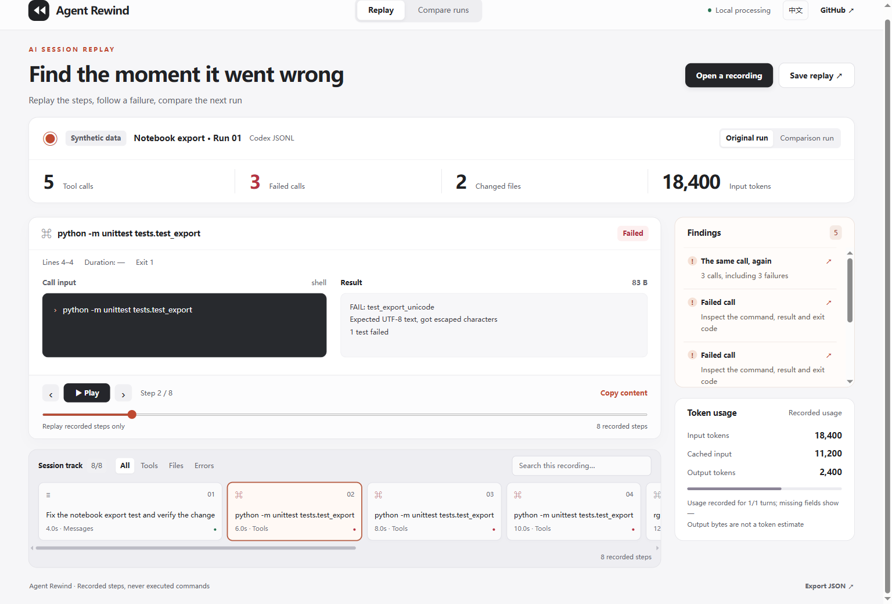

# Agent Rewind · AI 编码会话复盘

**从 Codex 日志里找出重复执行、失败调用和过大的工具输出**

[打开会话复盘](https://chenpingan-dev.github.io/agent-rewind/) · [English](README.md)



适合使用 Codex CLI 的个人开发者：一次修改来回跑了很多轮，可以导出记录，定位具体步骤，再与另一轮运行对照

## 快速使用

需要 Python 3.11+，分析功能仅使用标准库，无需模型 API Key

```sh
git clone https://github.com/chenpingan-dev/agent-rewind.git
cd agent-rewind
python -m pip install .
agent-rewind examples/repeated-run.jsonl --compare examples/focused-run.jsonl --html replay.html --json report.json
```

浏览器打开 `replay.html` 即可回放和搜索，回放不会执行日志里的命令

自己的会话可以用 `codex exec --json "任务描述" > session.jsonl` 导出，再运行 `agent-rewind session.jsonl --html session.html`。前一条命令会真正运行 Codex 并可能修改工作区；本工具只读取你明确传入的日志

## 首版支持

- Codex exec JSONL，同一条调用的生命周期合并为一个步骤
- 点击诊断直接定位调用，保留原始日志行号
- 对照两次运行的调用数、失败数和已记录的 token 用量
- 中英文切换、报告导入导出、可离线分享的单文件 HTML

在线页面和仓库例子是合成数据。页面导入的是 CLI 生成的报告 JSON，原始 JSONL 要先通过 CLI 分析。缺失时间和用量显示 `—`，不推测成本或节省比例

重复操作不一定有问题，提示用于人工复查。当前只支持 Codex exec 导出格式，不读取内部会话目录。常见密钥会做尽力遮盖，但分享前仍需检查文本、路径和其他敏感信息。输入上限 16 MiB / 20,000 条记录，单次输出最多展示 16,384 个字符

```sh
python -m unittest discover -s tests -v
python scripts/build_demo.py
```

独立、AI 辅助开发的 MIT 开源项目，包含真实分析代码与合成测试数据
