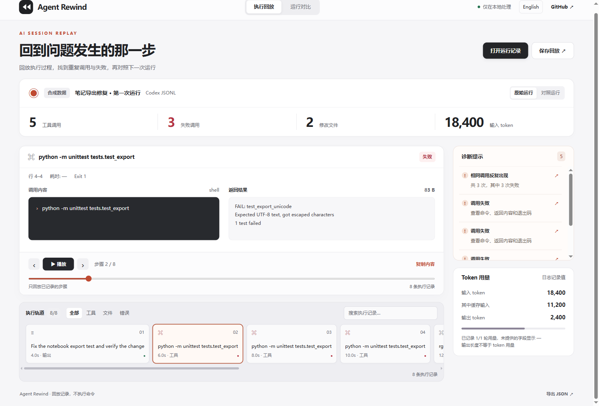

# Agent Rewind

### 给 Codex 会话加一个回放键

[打开会话回放 →](https://chenpingan-dev.github.io/agent-rewind/) · [安装使用](#安装使用) · [English](README.md) / [简体中文](README.zh-CN.md)

同一个测试跑了三遍，搜索结果刷了几屏，真正的修复藏在后面。**回到那次调用，直接看输入、结果和日志行号**，再与下一次运行对照



- **回放执行过程**：用播放控件逐步查看，也可以在轨道上直接跳转
- **定位异常调用**：从重复执行、失败和大输出提示跳到对应步骤
- **对照两次运行**：比较调用次数、失败次数与日志记录的 token 用量

读取 Codex exec 导出的 JSONL，使用 Python 标准库在本地分析，报告支持中英文与离线打开

## 安装使用

需要 Python 3.11+，无需模型 API Key

```sh
git clone https://github.com/chenpingan-dev/agent-rewind.git
cd agent-rewind
python -m pip install .
agent-rewind examples/repeated-run.jsonl --compare examples/focused-run.jsonl --html replay.html --json report.json
```

浏览器打开 `replay.html` 即可回放和搜索，回放不会执行日志里的命令

用 `codex exec --json "任务描述" > session.jsonl` 导出自己的会话，再运行 `agent-rewind session.jsonl --html session.html`

前一条命令会运行 Codex，并可能修改工作区；Agent Rewind 只读取你传入的日志。页面导入的是 CLI 生成的报告 JSON，原始 JSONL 要先通过 CLI 分析

## 数据与分析范围

在线回放和仓库内的记录使用合成数据。同一调用的生命周期会合并为一个步骤，缺失时间和用量显示 `—`，不推测成本或节省比例

重复操作可能是合理重试，诊断用于人工复查。当前仅支持 Codex exec JSONL，不读取内部会话目录，也不自动扫描其他目录

常见密钥会做尽力遮盖，分享前仍需检查文本、路径和其他敏感信息。输入上限 16 MiB / 20,000 条记录，单次输出最多展示 16,384 个字符

## 本地开发

```sh
python -m unittest discover -s tests -v
python scripts/build_demo.py
```

[界面设计](docs/design.md) · [架构](docs/architecture.md) · [路线图](docs/roadmap.md) · [参与贡献](CONTRIBUTING.md)

MIT · 独立、AI 辅助开发 · 与 OpenAI 无隶属关系
